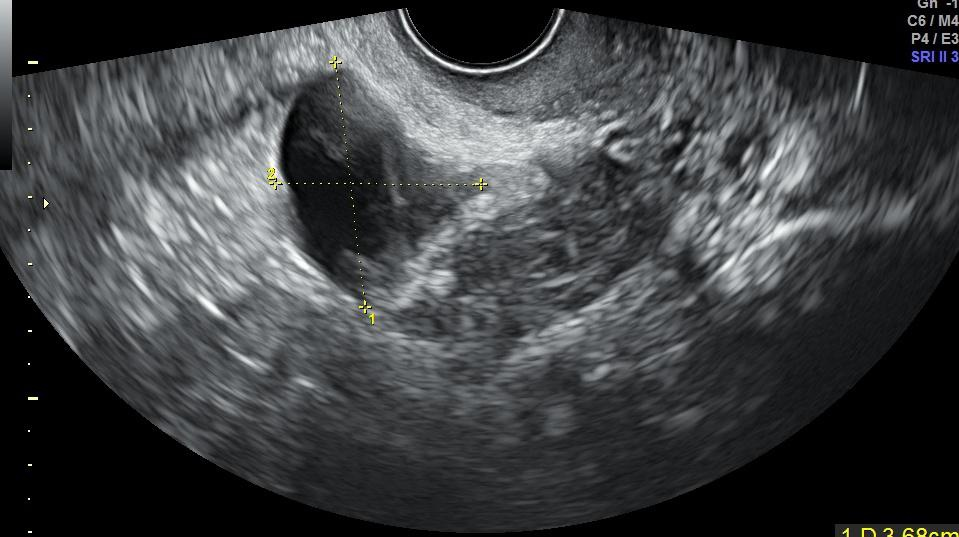

# I. MMOTU 2D (OTU_2d) Dataset

## 1. Dataset Overview
**MMOTU 2D (`OTU_2d`)** is a subset of the **MMOTU** (*Multi-Modality Ovarian Tumor Ultrasound*) benchmark dataset, designed for ovarian tumor recognition, classification, and semantic segmentation in 2D ultrasound imaging.

- **Total Images**: 1,469 2D ultrasound images.
- **Data Splits**:
  - **Train**: 1,000 images
  - **Validation**: 469 images
- **Main Tasks**:
  - **Classification**: 8-class ovarian tumor and normal ovary categorization.
  - **Segmentation**: Pixel-level tumor boundary delineations (Multi-class masks & Binary masks).

### Categories (Classes 0 – 7):
| ID | Category Name | Description / Type | Train | Val | Total |
|:--:|:--------------|:-------------------|:-----:|:---:|:-----:|
| **0** | Chocolate cyst | Ovarian endometrioma | 226 | 110 | 336 |
| **1** | Serous cystadenoma | Benign cystic tumor | 153 | 66 | 219 |
| **2** | Teratoma | Mature cystic teratoma | 228 | 108 | 336 |
| **3** | Theca cell tumor | Stromal tumor | 57 | 31 | 88 |
| **4** | Simple cyst | Functional/simple fluid cyst | 47 | 19 | 66 |
| **5** | Normal ovary | Healthy ovarian tissue | 180 | 87 | 267 |
| **6** | Mucinous cystadenoma | Benign epithelial tumor | 71 | 33 | 104 |
| **7** | High-grade serous | High-grade serous carcinoma (Malignant) | 38 | 15 | 53 |

---

## 2. Sample Image

<p align="center">
  
</p>

---

## 3. Directory Structure

```text
OTU_2d/
├── images/             # All 1,469 original ultrasound images (.JPG)
├── annotations/        # Ground-truth segmentation masks (.PNG)
├── train.txt           # Image IDs for the training split (1,000 samples)
├── val.txt             # Image IDs for the validation split (469 samples)
├── train_cls.txt       # Training split with class labels (<image_name> <class_id>)
├── val_cls.txt         # Validation split with class labels (<image_name> <class_id>)
└── README.md           # Dataset documentation
```

## II. OvaTus dataset
- I have a private dataset for the paper, that is OvaTus ad if you want to check it, let's contact me to open !